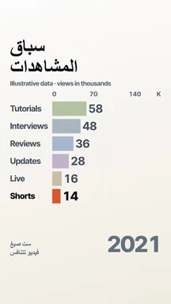
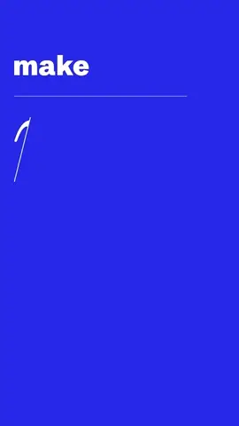
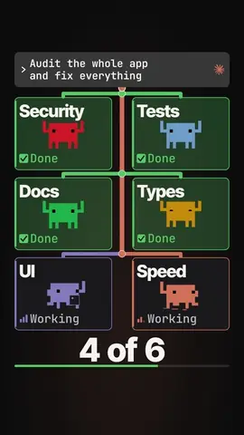
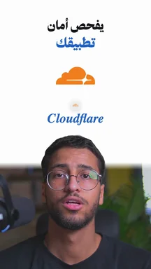

# Arabic Motion Kit

Five featured motion graphics and six original animations with editable source for vertical video. Use Claude Code or Codex to adapt the words and timing to your reel.

[Open the gallery](https://abdallahkht.github.io/arabic-motion-kit/) · [Download the kit](https://github.com/abdallahkht/arabic-motion-kit/releases/latest/download/arabic-motion-kit.zip) · [دليل الإعداد بالعربي](docs/setup-ar.md)

<table><tr><td align="center"><a href="https://abdallahkht.github.io/arabic-motion-kit/?clip=cutaway"></a><br><b>Cutaway</b><br>ماذا وراء الريل؟<br><a href="https://github.com/abdallahkht/arabic-motion-kit/tree/main/src/cutaway">Scene code</a> · <a href="https://github.com/abdallahkht/arabic-motion-kit/blob/main/catalog/cutaway/example.json">Settings</a></td><td align="center"><a href="https://abdallahkht.github.io/arabic-motion-kit/?clip=campaign-map"></a><br><b>Campaign Map</b><br>رحلة حول العالم<br><a href="https://github.com/ctskool/chase-animations/tree/95d8925f41884bfce339f546cec109f3c731d209/blocks/campaign-map">Scene code</a> · <a href="https://github.com/abdallahkht/arabic-motion-kit/blob/main/examples/featured/campaign-map.json">Settings</a></td><td align="center"><a href="https://abdallahkht.github.io/arabic-motion-kit/?clip=scale-reveal"></a><br><b>Scale Reveal</b><br>مليون ورقة فوق بعض<br><a href="https://github.com/ctskool/chase-animations/tree/95d8925f41884bfce339f546cec109f3c731d209/blocks/scale-reveal">Scene code</a> · <a href="https://github.com/abdallahkht/arabic-motion-kit/blob/main/examples/featured/scale-reveal.json">Settings</a></td></tr><tr><td align="center"><a href="https://abdallahkht.github.io/arabic-motion-kit/?clip=iceberg"></a><br><b>Iceberg</b><br>خلف كواليس الريل<br><a href="https://github.com/ctskool/chase-animations/tree/95d8925f41884bfce339f546cec109f3c731d209/blocks/iceberg">Scene code</a> · <a href="https://github.com/abdallahkht/arabic-motion-kit/blob/main/examples/featured/iceberg.json">Settings</a></td><td align="center"><a href="https://abdallahkht.github.io/arabic-motion-kit/?clip=ranking-bars"></a><br><b>Ranking Bars</b><br>سباق المشاهدات<br><a href="https://github.com/ctskool/chase-animations/tree/95d8925f41884bfce339f546cec109f3c731d209/blocks/ranking-bars">Scene code</a> · <a href="https://github.com/abdallahkht/arabic-motion-kit/blob/main/examples/featured/ranking-bars.json">Settings</a></td></tr></table>

### Original motion examples

<table><tr><td align="center"><a href="https://abdallahkht.github.io/arabic-motion-kit/?clip=isometric-flow"></a><br><b>Isometric flow</b><br><a href="https://github.com/abdallahkht/arabic-motion-kit/tree/main/examples/originals/blocks/isometric-flow">Scene code</a></td><td align="center"><a href="https://abdallahkht.github.io/arabic-motion-kit/?clip=blue-editorial"></a><br><b>Blue editorial</b><br><a href="https://github.com/abdallahkht/arabic-motion-kit/tree/main/examples/originals/blocks/blue-editorial">Scene code</a></td><td align="center"><a href="https://abdallahkht.github.io/arabic-motion-kit/?clip=ink-wash"></a><br><b>Ink Wash</b><br><a href="https://github.com/abdallahkht/arabic-motion-kit/tree/main/examples/originals/blocks/ink-wash">Scene code</a></td></tr><tr><td align="center"><a href="https://abdallahkht.github.io/arabic-motion-kit/?clip=hours-collapse"></a><br><b>Hours collapse</b><br><a href="https://github.com/abdallahkht/arabic-motion-kit/tree/main/examples/originals/blocks/hours-collapse">Scene code</a></td><td align="center"><a href="https://abdallahkht.github.io/arabic-motion-kit/?clip=agent-fan-out"></a><br><b>Agent fan-out</b><br><a href="https://github.com/abdallahkht/arabic-motion-kit/tree/main/examples/originals/blocks/agent-fan-out">Scene code</a></td><td align="center"><a href="https://abdallahkht.github.io/arabic-motion-kit/?clip=app-launch"></a><br><b>App launch</b><br><a href="https://github.com/abdallahkht/arabic-motion-kit/tree/main/examples/originals/blocks/app-launch">Scene code</a></td></tr></table>

[Files and render instructions](examples/originals)

### Reel example

<a href="https://abdallahkht.github.io/arabic-motion-kit/?clip=cloudflare-edit"></a>

**Cloudflare Security Audit** · The opening shot uses a cutout to place the graphic behind the presenter’s head.

### Make your own

Download and unzip the kit. Open the folder in Claude Code or Codex and say:

> اقرأ دليل الإعداد، جهّز المشروع، واعمل لي حركة Cutaway بالعربي عن فكرة الريل.

Install Node.js 22+ and FFmpeg, run `npm install` and `npm run setup`, then reopen your assistant session. The kit includes three skills: **animate** for a single motion graphic, **explain** for a narrated sequence, and **video-fx** for effects on footage.

**Cutaway** runs directly from this kit. Change the five labels in [its settings](catalog/cutaway/example.json). **Campaign Map, Scale Reveal, Iceberg and Ranking Bars** use the existing template engine with [our bilingual settings](examples/featured). To render these four yourself, point the assistant to your installed [template pack](https://github.com/ctskool/chase-animations). The finished MP4s play without installing either engine.

```sh
npm run motion -- animate cutaway --out work/my-cutaway
npm run motion -- render work/my-cutaway --out renders/my-cutaway.mp4
node scripts/featured.mjs iceberg "/path/to/installed-template-pack" renders/my-iceberg.mp4
```

[Commands](docs/commands-ar.md) · [Sources and media permissions](docs/credits.md) · [Reel Studio editor](https://github.com/abdallahkht/abdallah-reel-studio)
