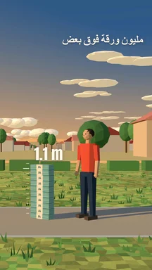
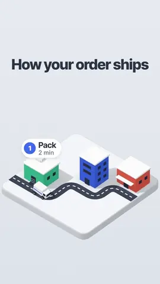
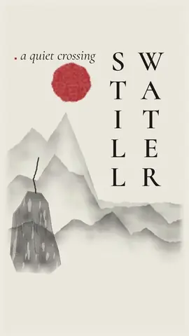
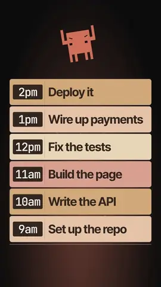
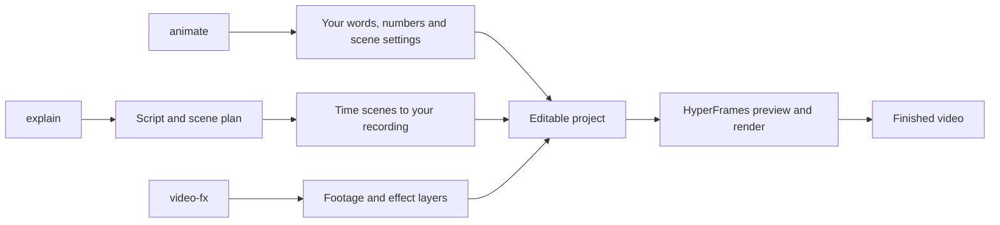

# Arabic Motion Kit

Five featured motion graphics and six original animations with editable source for vertical video. Use Claude Code or Codex to adapt the words and timing to your reel.

[Open the gallery](https://abdallahkht.github.io/arabic-motion-kit/) · [Download the kit](https://github.com/abdallahkht/arabic-motion-kit/releases/latest/download/arabic-motion-kit.zip) · [دليل الإعداد بالعربي](docs/setup-ar.md)

<table><tr><td align="center"><a href="https://abdallahkht.github.io/arabic-motion-kit/?clip=cutaway"></a><br><b>Cutaway</b><br>ماذا وراء الريل؟<br><a href="https://github.com/abdallahkht/arabic-motion-kit/tree/main/src/cutaway">Scene code</a> · <a href="https://github.com/abdallahkht/arabic-motion-kit/blob/main/catalog/cutaway/example.json">Settings</a></td><td align="center"><a href="https://abdallahkht.github.io/arabic-motion-kit/?clip=campaign-map"></a><br><b>Campaign Map</b><br>رحلة حول العالم<br><a href="https://github.com/ctskool/chase-animations/tree/95d8925f41884bfce339f546cec109f3c731d209/blocks/campaign-map">Scene code</a> · <a href="https://github.com/abdallahkht/arabic-motion-kit/blob/main/examples/featured/campaign-map.json">Settings</a></td><td align="center"><a href="https://abdallahkht.github.io/arabic-motion-kit/?clip=scale-reveal"></a><br><b>Scale Reveal</b><br>مليون ورقة فوق بعض<br><a href="https://github.com/ctskool/chase-animations/tree/95d8925f41884bfce339f546cec109f3c731d209/blocks/scale-reveal">Scene code</a> · <a href="https://github.com/abdallahkht/arabic-motion-kit/blob/main/examples/featured/scale-reveal.json">Settings</a></td></tr><tr><td align="center"><a href="https://abdallahkht.github.io/arabic-motion-kit/?clip=iceberg"></a><br><b>Iceberg</b><br>خلف كواليس الريل<br><a href="https://github.com/ctskool/chase-animations/tree/95d8925f41884bfce339f546cec109f3c731d209/blocks/iceberg">Scene code</a> · <a href="https://github.com/abdallahkht/arabic-motion-kit/blob/main/examples/featured/iceberg.json">Settings</a></td><td align="center"><a href="https://abdallahkht.github.io/arabic-motion-kit/?clip=ranking-bars"></a><br><b>Ranking Bars</b><br>سباق المشاهدات<br><a href="https://github.com/ctskool/chase-animations/tree/95d8925f41884bfce339f546cec109f3c731d209/blocks/ranking-bars">Scene code</a> · <a href="https://github.com/abdallahkht/arabic-motion-kit/blob/main/examples/featured/ranking-bars.json">Settings</a></td></tr></table>

### Original motion examples

<table><tr><td align="center"><a href="https://abdallahkht.github.io/arabic-motion-kit/?clip=isometric-flow"></a><br><b>Isometric flow</b><br><a href="https://github.com/abdallahkht/arabic-motion-kit/tree/main/examples/originals/blocks/isometric-flow">Scene code</a></td><td align="center"><a href="https://abdallahkht.github.io/arabic-motion-kit/?clip=blue-editorial"></a><br><b>Blue editorial</b><br><a href="https://github.com/abdallahkht/arabic-motion-kit/tree/main/examples/originals/blocks/blue-editorial">Scene code</a></td><td align="center"><a href="https://abdallahkht.github.io/arabic-motion-kit/?clip=ink-wash"></a><br><b>Ink Wash</b><br><a href="https://github.com/abdallahkht/arabic-motion-kit/tree/main/examples/originals/blocks/ink-wash">Scene code</a></td></tr><tr><td align="center"><a href="https://abdallahkht.github.io/arabic-motion-kit/?clip=hours-collapse"></a><br><b>Hours collapse</b><br><a href="https://github.com/abdallahkht/arabic-motion-kit/tree/main/examples/originals/blocks/hours-collapse">Scene code</a></td><td align="center"><a href="https://abdallahkht.github.io/arabic-motion-kit/?clip=agent-fan-out"></a><br><b>Agent fan-out</b><br><a href="https://github.com/abdallahkht/arabic-motion-kit/tree/main/examples/originals/blocks/agent-fan-out">Scene code</a></td><td align="center"><a href="https://abdallahkht.github.io/arabic-motion-kit/?clip=app-launch"></a><br><b>App launch</b><br><a href="https://github.com/abdallahkht/arabic-motion-kit/tree/main/examples/originals/blocks/app-launch">Scene code</a></td></tr></table>

[Files and render instructions](examples/originals)

### Reel example

<a href="https://abdallahkht.github.io/arabic-motion-kit/?clip=cloudflare-edit"></a>

**Cloudflare Security Audit** · The opening shot uses a cutout to place the graphic behind the presenter’s head.

## Start here

**Just want the clips?** [Download the kit](https://github.com/abdallahkht/arabic-motion-kit/releases/latest/download/arabic-motion-kit.zip), unzip it, and drag an MP4 from [gallery/media](gallery/media) into your editor.

**Want to make your own?** Install Node.js 22 or newer and FFmpeg (including ffprobe). Open the unzipped folder in Claude Code or Codex. If you prefer Git, run:

```sh
git clone https://github.com/abdallahkht/arabic-motion-kit.git
cd arabic-motion-kit
```

From inside the kit folder, run:

```sh
npm install
npm run setup
npm run setup -- --check
```

Keep the folder in place and reopen your assistant session. Try this first:

> استخدم animate لعمل Cutaway بعنوان «شو اللي بخلّي الريل ينجح؟». خلّي آخر طبقة «الفكرة»، وصدّر الفيديو عمودي.

To try the same built-in scene from your terminal:

```sh
npm run motion -- animate cutaway --out work/my-cutaway
npm run motion -- render work/my-cutaway --out renders/my-cutaway.mp4
```

**For timing scenes to your voice**, install the optional speech tools with Python 3.10–3.13 available. The first transcription downloads the selected Whisper model.

```sh
npm run setup -- --speech
```

**For a graphic behind a person**, replace `my-shot.mp4` with your clip. The first command downloads the cutout model on first use. The second places the text behind the presenter.

```sh
npm run motion -- cutout my-shot.mp4 --out work/subject.mov
npm run motion -- video-fx echo --input my-shot.mp4 --cutout work/subject.mov --title "الفكرة" --out work/behind-head
npm run motion -- render work/behind-head --out renders/behind-head.mp4
```

[دليل الإعداد وحل المشاكل](docs/setup-ar.md) · [All commands](docs/commands-ar.md)

## How it’s built



- **animate** makes one visual, such as an opening title, comparison, or 3D cutaway. Change the five labels in the [Cutaway settings](catalog/cutaway/example.json) to tell a different story.
- **explain** turns a topic into a script and a sequence of scenes. Preview the sequence silently or supply a recording to align the scenes and captions to your words. [Sample scene plan](examples/next-word.json).
- **video-fx** adds an effect to a shot. For effects behind the presenter, it layers the original footage, the graphic, and the isolated person. [Video effects guide](skills/video-fx/SKILL.md).

**Which scene files do I need?** Cutaway runs directly from the main kit. The six original examples include their own scene code and [render instructions](examples/originals). For Campaign Map, Scale Reveal, Iceberg, and Ranking Bars, use the [bilingual settings](examples/featured) with an installed copy of the [source template pack](https://github.com/ctskool/chase-animations):

```sh
node scripts/featured.mjs iceberg "/path/to/installed-template-pack" renders/my-iceberg.mp4
```

| Folder | What you’ll find |
| --- | --- |
| [skills/](skills) | The instructions Claude Code or Codex follows for animation, explainers, and video effects |
| [catalog/](catalog) | Built-in animation presets with editable text, colors, and values |
| [src/](src) | The renderer commands, project builder, effects, and [3D Cutaway source](src/cutaway) |
| [examples/](examples) | Five explainer plans, a custom scene, sample footage, and the featured settings |
| [examples/originals/blocks/](examples/originals/blocks) | The six original scenes, each with its code, settings, and README |
| [assets/](assets) | Arabic fonts and eight sound effects |
| [gallery/media/](gallery/media) | Finished MP4s and poster images |
| [scripts/](scripts) | Setup, transcription, timing, and publishing tools |
| [docs/](docs) | Setup, commands, capabilities, validation, and credits |

## What works where

| System | Verification |
| --- | --- |
| macOS on Apple Silicon | Setup, local rendering, Arabic word timing, subject cutouts, and transparent exports tested. |
| Windows | Setup includes a Windows install path. End-to-end rendering is unverified on Windows hardware. |
| Linux | Automated repository checks run on Ubuntu. End-to-end rendering is unverified on Linux hardware. |

[Validation details](docs/testing.md) · [Automated checks](.github/workflows/checks.yml)

## Credits

Arabic Motion Kit uses HyperFrames for rendering, GSAP for animation, and IBM Plex Sans Arabic for type. The six original scenes include upstream credits and font notices. See [credits and media permissions](docs/credits.md), [original scene credits](examples/originals/UPSTREAM-CREDITS.md), and the [kit license](LICENSE).

For frame-by-frame review and small cut corrections, open the finished reel in [Reel Studio](https://github.com/abdallahkht/abdallah-reel-studio).
