<p align="center"><a href="https://abdallahkht.github.io/arabic-motion-kit/">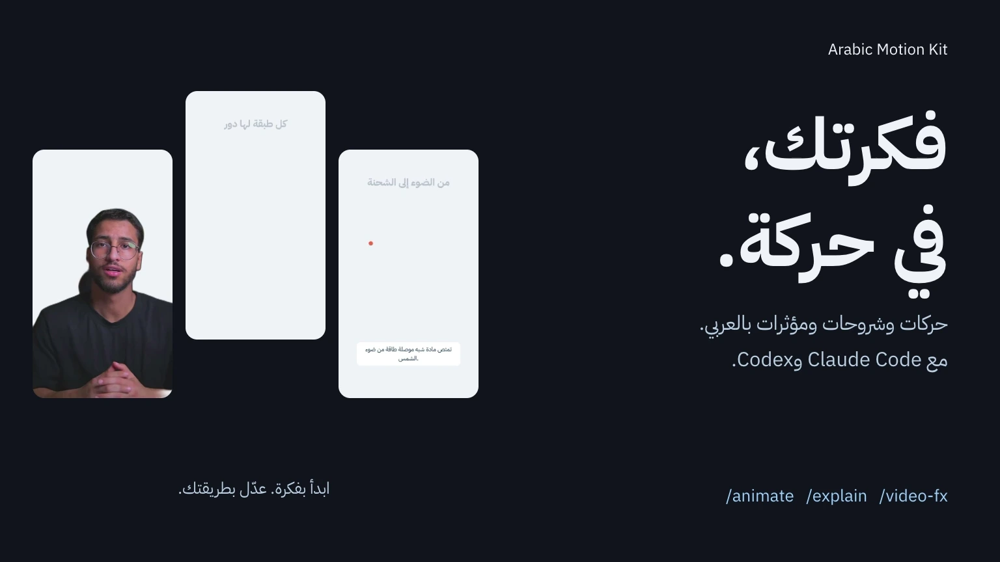</a></p>

# Arabic Motion Kit

**قل الفكرة. وشاهدها تتحرك.**

مهارات عربية لـClaude Code وCodex: 42 إعداد حركة، 16 مؤثراً على فيديوهاتك، وخمس شروحات تعليمية قابلة للتعديل. كود وأمثلة أصلية، وخط عربي ومؤثرات صوتية مرفقة.

[المعرض المتحرك](https://abdallahkht.github.io/arabic-motion-kit/) · [تحميل ZIP](https://github.com/abdallahkht/arabic-motion-kit/archive/refs/heads/main.zip) · [دليل الإعداد](docs/setup-ar.md) · [الأوامر](docs/commands-ar.md)

## ثلاث مهارات

| المهارة | تعطيها | تحصل على |
|---|---|---|
| `animate` | فكرة حركة أو كلمات وأرقام | عنوان، مقارنة، رسم، واجهة أو طبقة شفافة |
| `explain` | جملة مثل «اشرح كيف يعمل…» | بحث ونص ومشاهد؛ ثم فيديو بصوتك بعد التسجيل |
| `video-fx` | فيديوك والمؤثر والوقت أو الكلمة | مؤثر في المقطع، مع فصل الشخص عند الحاجة |

المساعد يجهّز الملفات وينفّذ الخطوات. أسلوبك ومهاراتك الحالية تبقى المرجع. هذه المهارات عامة، وأسماؤها ليست أسماء أشخاص.

## ابدأ هنا

نزّل ZIP وفك الضغط، ثم افتح المجلد في Claude Code أو Codex وقل:

> اقرأ README وثبّت هذا المشروع، ثم جهّز لي أول حركة بالعربي.

تحتاج Node.js 22+ وFFmpeg وحسابك الخاص في المساعد. أو نفّذ:

```bash
npm install
npm run setup
```

أعد فتح جلسة المساعد. [التعليمات بالعربي، خطوة خطوة](docs/setup-ar.md).

## شرح كامل من فكرة

> استخدم explain: اشرح كيف يختار نموذج اللغة تكملة الجملة. بالعربي، بمشاهد واضحة ومصادر، ثم جهّز النص لأسجله بصوتي.

المساعد يبحث، يكتب النص، ويختار المشاهد. يمكنك رؤية معاينة صامتة أولاً؛ بعد تسجيلك يُضبط التوقيت والكابشن على صوتك. لا يوجد صوت اصطناعي مفروض ولا استنساخ صوت. الأمثلة التالية صامتة، وخططها ومصادرها في [examples](examples).

<table>
<tr><td width="25%" align="center"><a href="https://abdallahkht.github.io/arabic-motion-kit/">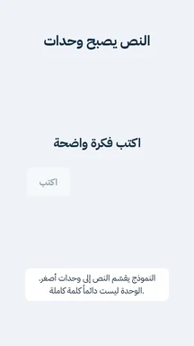</a><br><b>كيف يختار النموذج التكملة؟</b><br><code>explain-next-word</code></td><td width="25%" align="center"><a href="https://abdallahkht.github.io/arabic-motion-kit/">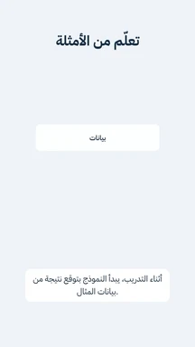</a><br><b>كيف يتعلم النموذج؟</b><br><code>explain-ai-training</code></td><td width="25%" align="center"><a href="https://abdallahkht.github.io/arabic-motion-kit/">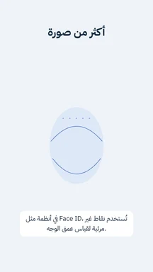</a><br><b>كيف يتعرف الهاتف على الوجه؟</b><br><code>explain-face-unlock</code></td><td width="25%" align="center"><a href="https://abdallahkht.github.io/arabic-motion-kit/">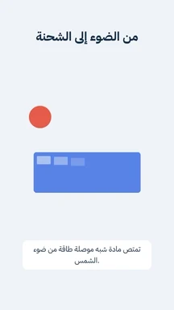</a><br><b>كيف يصير الضوء كهرباء؟</b><br><code>explain-solar-power</code></td></tr>
<tr><td width="25%" align="center"><a href="https://abdallahkht.github.io/arabic-motion-kit/">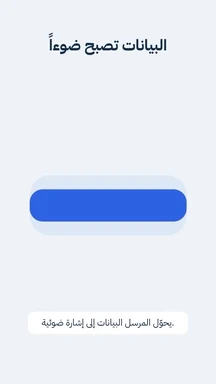</a><br><b>كيف تنتقل البيانات بالضوء؟</b><br><code>explain-fiber-internet</code></td></tr>
</table>

## مؤثرات على تصويرك

> استخدم video-fx echo على كلمة «الفكرة» في فيديوي. حافظ على لوني، ولا تغطِ وجهي.

فصل الخلفية محلي وحقيقي للمؤثرات التي تحتاجه. المواضع قابلة للتعديل، ويجب فحصها على تصويرك؛ لا يوجد تتبع رأس تلقائي في هذا الإصدار.

<table>
<tr><td width="25%" align="center"><a href="https://abdallahkht.github.io/arabic-motion-kit/">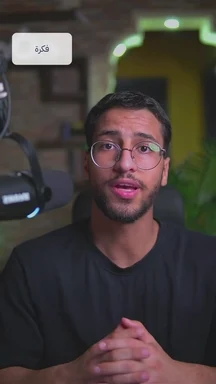</a><br><b>بطاقات حولك</b><br><code>fx-glass-cards</code></td><td width="25%" align="center"><a href="https://abdallahkht.github.io/arabic-motion-kit/">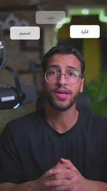</a><br><b>مدارات خلفك</b><br><code>fx-orbit</code></td><td width="25%" align="center"><a href="https://abdallahkht.github.io/arabic-motion-kit/">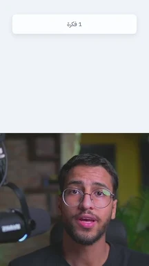</a><br><b>لوحة ترتيب فوقك</b><br><code>fx-tier-board</code></td><td width="25%" align="center"><a href="https://abdallahkht.github.io/arabic-motion-kit/">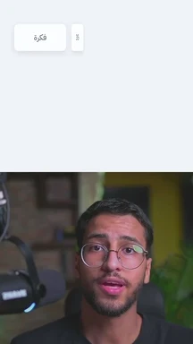</a><br><b>رسم فوقك</b><br><code>fx-chart-panel</code></td></tr>
<tr><td width="25%" align="center"><a href="https://abdallahkht.github.io/arabic-motion-kit/">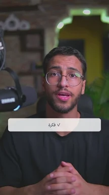</a><br><b>قائمة مهام</b><br><code>fx-checklist</code></td><td width="25%" align="center"><a href="https://abdallahkht.github.io/arabic-motion-kit/"></a><br><b>إضاءة الموضوع</b><br><code>fx-spotlight</code></td><td width="25%" align="center"><a href="https://abdallahkht.github.io/arabic-motion-kit/"></a><br><b>نوافذ خلفك</b><br><code>fx-browser-stack</code></td><td width="25%" align="center"><a href="https://abdallahkht.github.io/arabic-motion-kit/">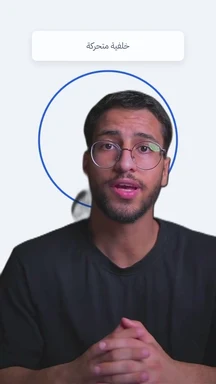</a><br><b>خلفية متحركة</b><br><code>fx-backdrop</code></td></tr>
<tr><td width="25%" align="center"><a href="https://abdallahkht.github.io/arabic-motion-kit/">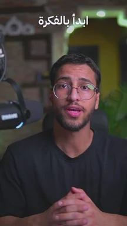</a><br><b>كلمة خلفك</b><br><code>fx-echo</code></td><td width="25%" align="center"><a href="https://abdallahkht.github.io/arabic-motion-kit/">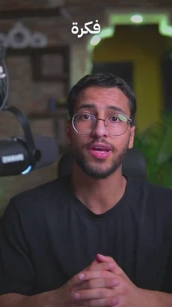</a><br><b>تصحيح كلمة</b><br><code>fx-correction</code></td><td width="25%" align="center"><a href="https://abdallahkht.github.io/arabic-motion-kit/">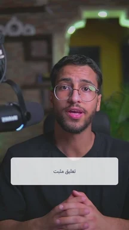</a><br><b>تعليق مثبت</b><br><code>fx-pinned-comment</code></td><td width="25%" align="center"><a href="https://abdallahkht.github.io/arabic-motion-kit/">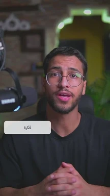</a><br><b>إشعارات جانبية</b><br><code>fx-pings</code></td></tr>
<tr><td width="25%" align="center"><a href="https://abdallahkht.github.io/arabic-motion-kit/">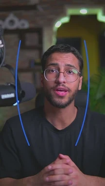</a><br><b>تحديد الموضوع</b><br><code>fx-focus-ring</code></td><td width="25%" align="center"><a href="https://abdallahkht.github.io/arabic-motion-kit/">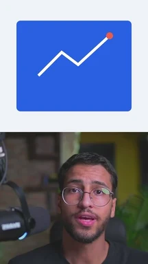</a><br><b>لقطة مساندة فوقك</b><br><code>fx-broll-panel</code></td><td width="25%" align="center"><a href="https://abdallahkht.github.io/arabic-motion-kit/">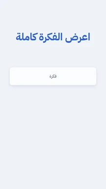</a><br><b>تغطية قراءة النص</b><br><code>fx-reading-cover</code></td><td width="25%" align="center"><a href="https://abdallahkht.github.io/arabic-motion-kit/">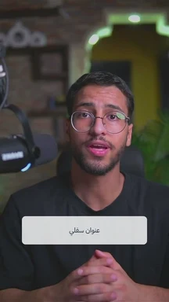</a><br><b>عنوان سفلي</b><br><code>fx-keyword-tag</code></td></tr>
</table>

## الحركات

> استخدم animate layer-stack لشرح طبقات المونتاج: الصورة والحركة والكابشن والصوت.

النصوص والألوان والأرقام قابلة للتغيير. الأرقام في الأمثلة توضيحية، والخرائط رسومات تعليمية حتى تضيف بيانات خريطة حقيقية.

### عناوين

<table>
<tr><td width="25%" align="center"><a href="https://abdallahkht.github.io/arabic-motion-kit/">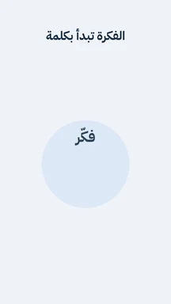</a><br><b>كلمة تصل في وقتها</b><br><code>focus-word</code></td><td width="25%" align="center"><a href="https://abdallahkht.github.io/arabic-motion-kit/">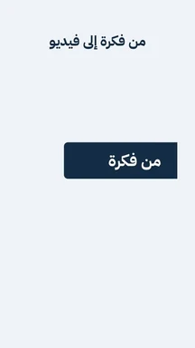</a><br><b>عنوان على مرحلتين</b><br><code>split-title</code></td><td width="25%" align="center"><a href="https://abdallahkht.github.io/arabic-motion-kit/">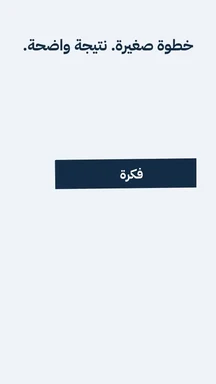</a><br><b>شريط متحرك</b><br><code>ribbon-title</code></td><td width="25%" align="center"><a href="https://abdallahkht.github.io/arabic-motion-kit/">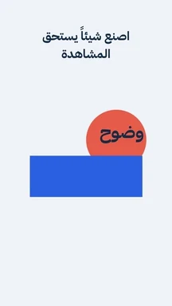</a><br><b>ملصق عربي</b><br><code>poster</code></td></tr>
<tr><td width="25%" align="center"><a href="https://abdallahkht.github.io/arabic-motion-kit/">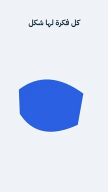</a><br><b>ظهور بالحبر</b><br><code>ink-reveal</code></td><td width="25%" align="center"><a href="https://abdallahkht.github.io/arabic-motion-kit/">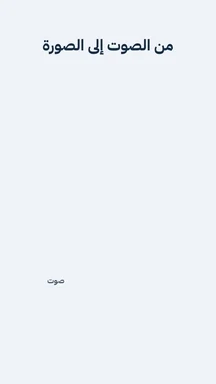</a><br><b>موجة إشارة</b><br><code>signal</code></td><td width="25%" align="center"><a href="https://abdallahkht.github.io/arabic-motion-kit/">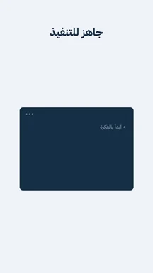</a><br><b>عنوان طرفية</b><br><code>terminal-title</code></td><td width="25%" align="center"><a href="https://abdallahkht.github.io/arabic-motion-kit/">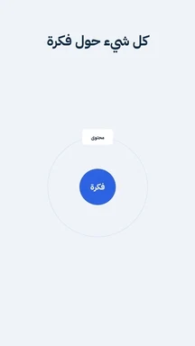</a><br><b>مدارات</b><br><code>orbit-logo</code></td></tr>
</table>

### مقارنات وأرقام

<table>
<tr><td width="25%" align="center"><a href="https://abdallahkht.github.io/arabic-motion-kit/">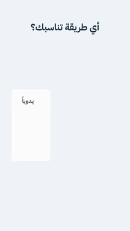</a><br><b>مقارنة واضحة</b><br><code>comparison</code></td><td width="25%" align="center"><a href="https://abdallahkht.github.io/arabic-motion-kit/">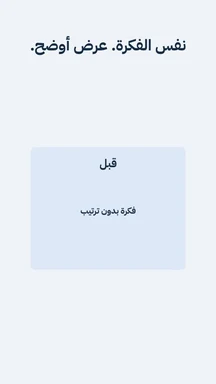</a><br><b>قبل وبعد</b><br><code>wipe</code></td><td width="25%" align="center"><a href="https://abdallahkht.github.io/arabic-motion-kit/">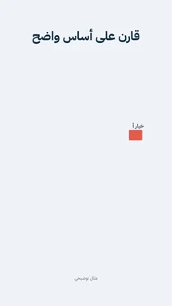</a><br><b>أعمدة مرتبة</b><br><code>ranked-bars</code></td><td width="25%" align="center"><a href="https://abdallahkht.github.io/arabic-motion-kit/">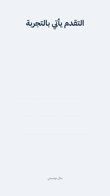</a><br><b>منحنى نمو</b><br><code>growth-chart</code></td></tr>
<tr><td width="25%" align="center"><a href="https://abdallahkht.github.io/arabic-motion-kit/">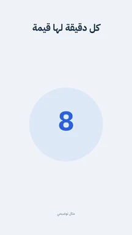</a><br><b>رقم كبير</b><br><code>metric-counter</code></td><td width="25%" align="center"><a href="https://abdallahkht.github.io/arabic-motion-kit/">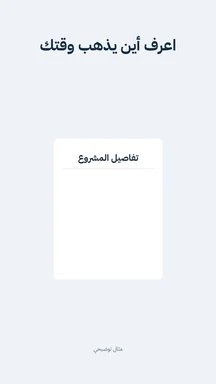</a><br><b>تفصيل التكلفة</b><br><code>receipt</code></td><td width="25%" align="center"><a href="https://abdallahkht.github.io/arabic-motion-kit/">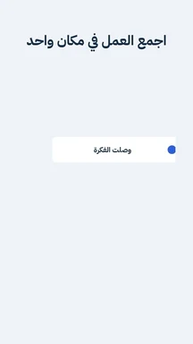</a><br><b>إشعارات</b><br><code>notifications</code></td><td width="25%" align="center"><a href="https://abdallahkht.github.io/arabic-motion-kit/">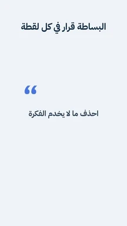</a><br><b>اقتباس</b><br><code>quote</code></td></tr>
<tr><td width="25%" align="center"><a href="https://abdallahkht.github.io/arabic-motion-kit/">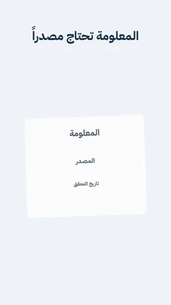</a><br><b>بطاقة مصدر</b><br><code>evidence-card</code></td><td width="25%" align="center"><a href="https://abdallahkht.github.io/arabic-motion-kit/">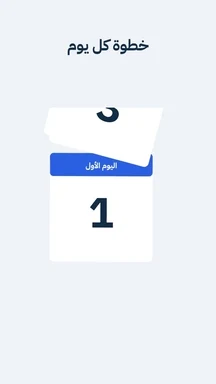</a><br><b>تقويم</b><br><code>calendar</code></td></tr>
</table>

### واجهات ومنتجات

<table>
<tr><td width="25%" align="center"><a href="https://abdallahkht.github.io/arabic-motion-kit/">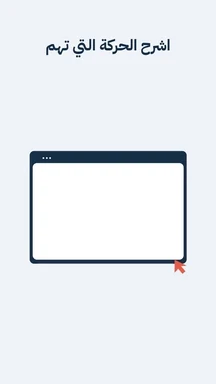</a><br><b>تركيز على واجهة</b><br><code>browser-focus</code></td><td width="25%" align="center"><a href="https://abdallahkht.github.io/arabic-motion-kit/">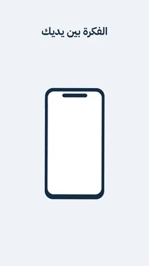</a><br><b>عرض هاتف</b><br><code>phone-demo</code></td><td width="25%" align="center"><a href="https://abdallahkht.github.io/arabic-motion-kit/">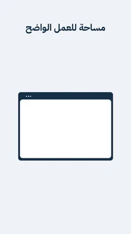</a><br><b>عرض حاسوب</b><br><code>laptop-demo</code></td><td width="25%" align="center"><a href="https://abdallahkht.github.io/arabic-motion-kit/">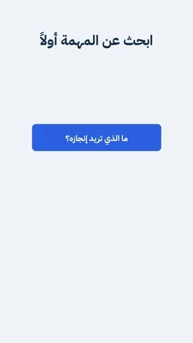</a><br><b>بحث ونتيجة</b><br><code>search-results</code></td></tr>
<tr><td width="25%" align="center"><a href="https://abdallahkht.github.io/arabic-motion-kit/">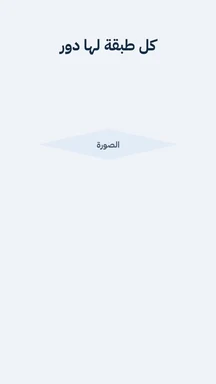</a><br><b>طبقات منفصلة</b><br><code>layer-stack</code></td><td width="25%" align="center"><a href="https://abdallahkht.github.io/arabic-motion-kit/">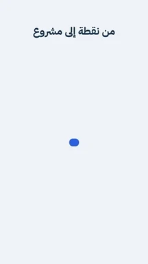</a><br><b>تحول واجهة</b><br><code>morph-ui</code></td></tr>
</table>

### شرح وعمليات

<table>
<tr><td width="25%" align="center"><a href="https://abdallahkht.github.io/arabic-motion-kit/">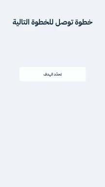</a><br><b>خطوات مترابطة</b><br><code>process-flow</code></td><td width="25%" align="center"><a href="https://abdallahkht.github.io/arabic-motion-kit/">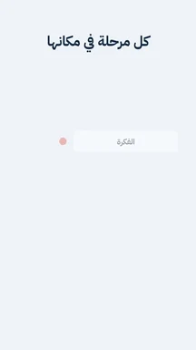</a><br><b>خط زمني</b><br><code>timeline</code></td><td width="25%" align="center"><a href="https://abdallahkht.github.io/arabic-motion-kit/">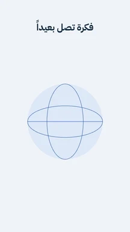</a><br><b>وصلات حول الكرة</b><br><code>globe-links</code></td><td width="25%" align="center"><a href="https://abdallahkht.github.io/arabic-motion-kit/">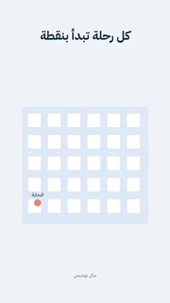</a><br><b>مسار على خريطة</b><br><code>route-map</code></td></tr>
<tr><td width="25%" align="center"><a href="https://abdallahkht.github.io/arabic-motion-kit/">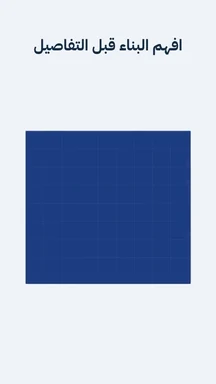</a><br><b>رسم هندسي</b><br><code>blueprint</code></td><td width="25%" align="center"><a href="https://abdallahkht.github.io/arabic-motion-kit/">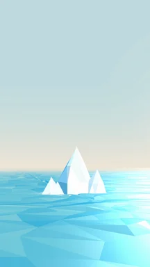</a><br><b>فوق السطح وتحته</b><br><code>iceberg</code></td><td width="25%" align="center"><a href="https://abdallahkht.github.io/arabic-motion-kit/"></a><br><b>مقارنة الحجم</b><br><code>scale-ladder</code></td><td width="25%" align="center"><a href="https://abdallahkht.github.io/arabic-motion-kit/"></a><br><b>مقطع داخلي</b><br><code>cutaway</code></td></tr>
<tr><td width="25%" align="center"><a href="https://abdallahkht.github.io/arabic-motion-kit/"></a><br><b>مسارات متعددة</b><br><code>campaign-map</code></td></tr>
</table>

### برمجة ووكلاء

<table>
<tr><td width="25%" align="center"><a href="https://abdallahkht.github.io/arabic-motion-kit/"></a><br><b>جلسة تنفيذ</b><br><code>terminal-session</code></td><td width="25%" align="center"><a href="https://abdallahkht.github.io/arabic-motion-kit/"></a><br><b>فريق وكلاء</b><br><code>agent-network</code></td><td width="25%" align="center"><a href="https://abdallahkht.github.io/arabic-motion-kit/"></a><br><b>دورة تحسين</b><br><code>agent-cycle</code></td><td width="25%" align="center"><a href="https://abdallahkht.github.io/arabic-motion-kit/"></a><br><b>فحص النتائج</b><br><code>test-matrix</code></td></tr>
<tr><td width="25%" align="center"><a href="https://abdallahkht.github.io/arabic-motion-kit/"></a><br><b>تركيز على الكود</b><br><code>code-focus</code></td><td width="25%" align="center"><a href="https://abdallahkht.github.io/arabic-motion-kit/"></a><br><b>شجرة ملفات</b><br><code>file-tree</code></td><td width="25%" align="center"><a href="https://abdallahkht.github.io/arabic-motion-kit/"></a><br><b>قبل وبعد في الكود</b><br><code>code-diff</code></td><td width="25%" align="center"><a href="https://abdallahkht.github.io/arabic-motion-kit/"></a><br><b>ضغط الوقت</b><br><code>time-saved</code></td></tr>
<tr><td width="25%" align="center"><a href="https://abdallahkht.github.io/arabic-motion-kit/"></a><br><b>لوحة ترتيب</b><br><code>leaderboard</code></td></tr>
</table>

## كيف تعمل الأدوات؟


| المجلد | ما فيه |
|---|---|
| [skills](skills) | المهارات الثلاث |
| [catalog](catalog) | كل حركة وإعداداتها العربية |
| [src](src) | بناء المشاهد والمؤثرات وأداة الأوامر |
| [examples](examples) | خطط الشروحات وقالب مشهد مخصص وتصوير للتجربة |
| [assets/sounds](assets/sounds) | ثمانية أصوات أصلية قصيرة |
| [gallery](gallery) | 63 مثالاً متحركاً بلا مسار صوت |
| [docs](docs) | الإعداد والأوامر والحدود والتراخيص |

## مع محرر الريلز

هذه مكتبة إنشاء الحركة والشرح. [Reel Studio](https://github.com/abdallahkht/abdallah-reel-studio) مشروع منفصل لمراجعة الفيديو النهائي وتصحيح القصات الصغيرة. يمكنك استخدام هذه المكتبة وحدها، أو مع المحرر ومهارات المونتاج الخاصة بك.

## قبل الاستخدام

الرسومات الحالية vector و2.5D. المعرض صامت بشكل دائم؛ الفيديوهات ليس فيها مسار صوت يمكن تشغيله. الفيديو النهائي الخاص بك يمكن أن يحتوي تسجيلك والمؤثرات. صور الواجهات الحقيقية والبحث على الإنترنت يستخدمان الأدوات المتاحة عند المساعد، وليسا خدمة تلقائية داخل أمر الرندر. [التفاصيل والحدود](docs/capabilities-ar.md).

تم اختبار الإصدار على Apple Silicon Mac؛ Windows وLinux لم يُختبرا فعلياً. [ما اختبرناه](docs/testing.md).

الكود الأصلي بترخيص MIT. الخط والاعتماديات وتصوير الشخص لها شروطها المبينة في [المصادر والتراخيص](docs/credits.md). لا توجد ملفات دورة مدفوعة أو مكتبة أصوات مشتراة ضمن التحميل.
